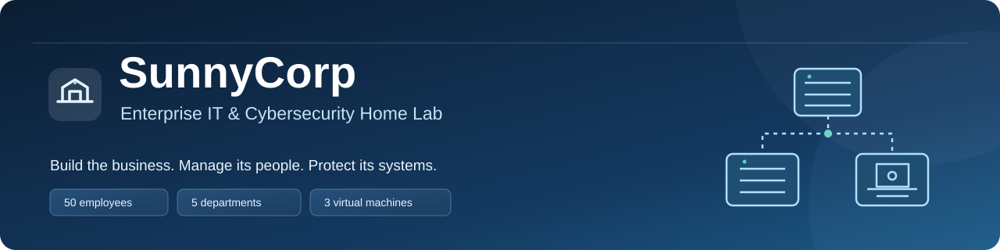
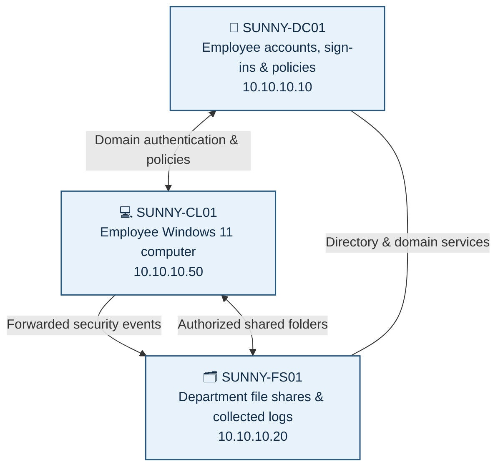

# Building a Company From Scratch — Then Securing It

**A hands-on Windows enterprise lab designed to show how IT teams build, operate, protect, and monitor a business.**

  

---

## 👋 Start here: What is SunnyCorp?

Imagine you're hired to run IT for a company with **50 employees**. People need accounts to sign in, folders for their work, rules that protect confidential information, and someone to investigate suspicious activity.

**SunnyCorp is that company — simulated entirely on my computer.** Instead of buying real servers or hiring 50 people, I built a virtual corporate network and created fictional employees. Then I tested what works, what gets blocked, and what gets logged.

**The simple story:** We **built** the company network → **created** employee accounts → **controlled** file access → **secured** computers → **monitored** suspicious activity.

> **Who is this for?** You can read this overview without knowing IT. If you're technical, the detailed build guides, scripts, and evidence will be organized in this repository as the portfolio is finalized.

## 🧭 What did I build?

| A real business needs… | SunnyCorp's solution | In plain English |
|:--|:--|:--|
| A company network | Private virtual network | A place for company computers to communicate |
| Employee identities | Active Directory | A central employee ID and login system |
| Departments and access rules | Security groups + Group Policy | People get the tools and files appropriate to their jobs |
| Shared company documents | Windows file server | Department-specific digital filing cabinets |
| Safe IT administration | Separate admin accounts + Windows LAPS | IT can fix computers without everyone having unrestricted power |
| Computer protection | Microsoft Defender + Firewall | Helps block threats and unwanted connections |
| Security investigations | Windows logs + Event Forwarding | Sends evidence from a workstation to a central monitoring server |

### At a glance

**50 fictional employees** · **5 departments** (IT, HR, Finance, Sales, Operations) · **3 virtual computers** · **1 private domain** · **6 technical phases completed**

## 🖥️ How the computers work together

Think of the **Domain Controller** as the company's ID office, the **File Server** as its secure filing cabinet, and the **Workstation** as an employee's desk.

All systems run inside an isolated **VirtualBox host-only network**, `10.10.10.0/24`, under the lab domain `corp.sunnylab.test`. No live company or real customer data is used.

## 🏗️ The six phases — explained simply

| Phase | The question we answered | What we did |
|:--|:--|:--|
| **01 · Build the network** | How do company computers talk? | Created and tested a private network and Windows virtual machines. |
| **02 · Set up company logins** | Who is allowed to sign in? | Installed Active Directory and DNS, created `corp.sunnylab.test`, and joined a workstation to the domain. |
| **03 · Create the company** | How do we manage 50 employees consistently? | Created 50 fictional accounts across five departments, security groups, and password/workstation policies. |
| **04 · Protect company files** | Can HR see Finance files? | Built five department shares, restricted access, automated drive mappings, and verified file-access logs. |
| **05 · Run & secure IT** | How do IT technicians work safely? | Tested onboarding/offboarding, separate admin identities, password rotation (LAPS), Defender, firewall, remote troubleshooting, and update checks. |
| **06 · Investigate security events** | How do we know when something happens? | Detected failed logins, tracked account changes, centralized Windows events, and wrote an investigation report. |

## ✅ Things I tested — not just configured

| Realistic scenario | Observed result |
|:--|:--|
| **New employee starts** | The test HR employee signed in and automatically received the HR network drive (`H:`). |
| **Employee opens another department's files** | Access to the Finance share was denied to the HR test account. |
| **Employee leaves** | Disabling the test account caused a new domain sign-in to be rejected. |
| **IT technician needs admin rights** | A separate James Wilson admin account could administer the workstation; it was not a Domain Admin. |
| **Local admin password must be protected** | Windows LAPS rotated the built-in Administrator password and backed it up encrypted to Active Directory. |
| **Unwanted software protection** | Microsoft Defender PUA protection changed from audit mode (`2`) to block mode (`1`). |
| **Help desk supports a computer remotely** | PowerShell Remoting successfully ran commands on the workstation from another virtual machine. |
| **Employee enters a wrong password** | Windows recorded Event `4625`, and a PowerShell script flagged repeated failures. |
| **SOC analyst watches multiple machines** | The file server's Forwarded Events log received workstation events `4624`, `4625`, and `4672`. |
| **Someone changes a privileged group** | Event `4728` identified who added a member and which group was changed. |

These are **controlled lab observations**, not claims about a real company's security. Some log deliveries were delayed during testing; switching the subscription to *Minimize Latency* did not fully resolve verification for every new event.

## 🔎 What an investigation looks like

**Scenario:** An employee account has failed sign-ins.

1. **Notice:** Windows records the failed login as Event `4625`.
2. **Investigate:** Check the account, computer, time, and failure reason.
3. **Correlate:** Look for additional failures and related account or privilege changes.
4. **Document:** Explain the evidence and distinguish a test or mistake from a real incident.

For SunnyCorp, these attempts were **authorized simulations**. We created a security investigation report, `IR-001`, to document that distinction.

## 📚 Explore the project

**This repository is being assembled phase by phase.** The overview is ready; detailed walkthroughs, sanitized screenshots, selected scripts, and the final report will be added and verified before the repository is made public.

| Section | What you'll find |
|:--|:--|
| `docs/` *(planned)* | Beginner-friendly stories plus detailed configuration steps |
| `scripts/` *(planned)* | PowerShell scripts used or adapted from the lab |
| `evidence/` *(planned)* | Screenshots that demonstrate real test results |
| `diagrams/` *(planned)* | Clear visuals of how the system works |
| `reports/` *(planned)* | Incident response write-up |
| `assets/` | Visual branding for this README |

### Key terms, without the jargon

- **Active Directory (AD):** A shared employee directory and login system.
- **Group Policy (GPO):** Company-wide computer settings managed from one place.
- **Security group:** A list of people who should receive the same access.
- **File permissions:** Rules controlling who may open or modify a folder.
- **Windows LAPS:** Automatically changes and securely stores a computer's local administrator password.
- **Windows Event Forwarding (WEF):** Sends selected computer activity records to one central server.
- **SOC:** Security Operations Center — the team that investigates security alerts.

## 🔐 Responsible lab publishing

This project uses fictional employee accounts, an isolated test domain, and synthetic security scenarios. Before public release, I will review screenshots, remove credentials and tokens, redact unnecessary identifiers, and keep temporary password files, private keys, and other secrets **out of the repository**.

---

**The takeaway:** SunnyCorp demonstrates the full IT lifecycle: **build → manage → secure → monitor → investigate.**

*Built as an independent, hands-on learning and portfolio project.*

