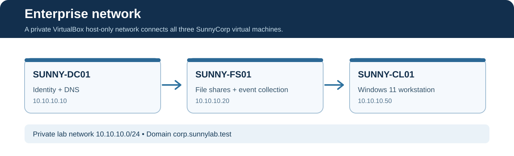
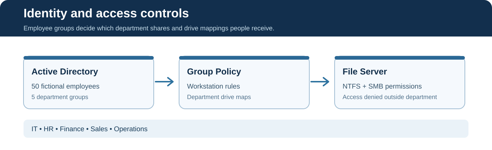
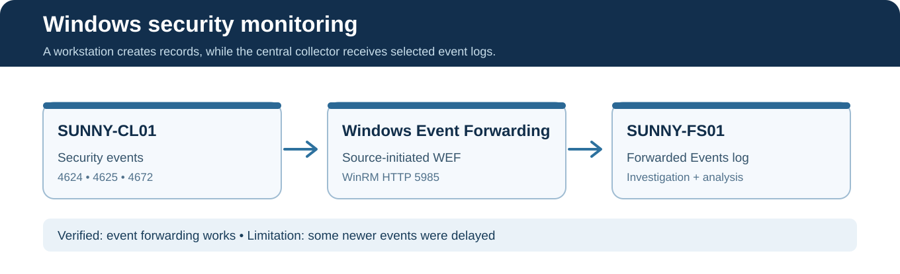

# SunnyCorp Architecture Diagrams

Three original, source-editable SVG diagrams visualize the verified SunnyCorp lab. The navy-and-white style matches the GitHub homepage.

## 1. Enterprise network

The three virtual computers use a private host-only network. **SUNNY-DC01** provides identities and DNS, **SUNNY-FS01** stores shared files and collects forwarded events, and **SUNNY-CL01** represents an employee computer.

## 2. Identity and access

The identity and permissions workflow: **Active Directory groups → Group Policy/drive mapping → SMB and NTFS access controls**. It summarizes the demonstrated security architecture; it is not a literal network packet-flow diagram.

## 3. Centralized monitoring

**SUNNY-CL01 → WEF → SUNNY-FS01**. We verified successful and failed login events reached the collector. Two later failed logons were observed locally but not confirmed at the collector before troubleshooting ended.

## Diagram integrity

- Architecture diagrams are **explanatory illustrations**, not screenshots.
- IP addresses and domain are fictional lab values.
- Only the three virtual machines actually configured are shown.
- The diagrams do not claim high availability, a dedicated SOC/SIEM, or production readiness.

[← Home](../README.md) · [View genuine screenshots](../evidence/GALLERY.md)
