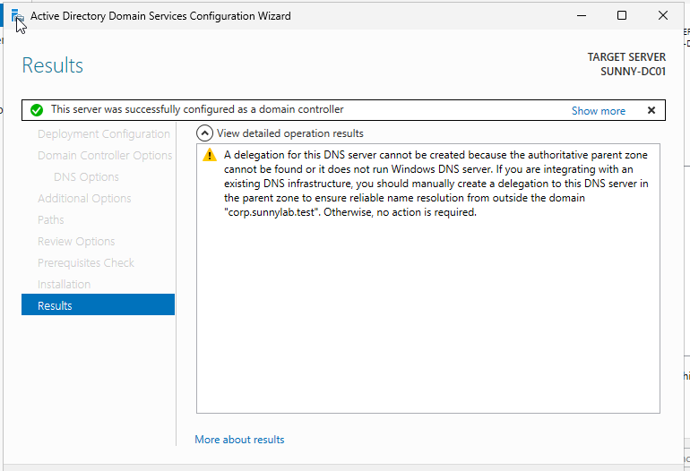
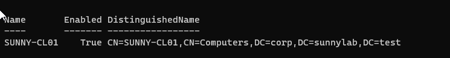

# Phase 02 — Create the Company's Login System

> **The simple question:** How do 50 people use company accounts without IT configuring every computer separately?

## A story anyone can follow

Think of **Active Directory** as a company's front desk and employee directory. When someone tries to sign in, the company checks whether that person has a valid account. The same system also keeps track of company computers and shared rules.

For SunnyCorp, our central front desk is `SUNNY-DC01`.

## Our setup

| Piece | Role |
|---|---|
| `SUNNY-DC01` | Windows Server 2025 Domain Controller |
| Active Directory Domain Services | Directory holding company accounts and devices |
| Domain | `corp.sunnylab.test` |
| Short/NetBIOS name | `CORP` |
| DNS | Runs on the Domain Controller; resolves company systems |
| `SUNNY-CL01` | Windows 11 PC joined to the company domain |

## What we did

### 1. Prepare Windows Server

Configured SUNNY-DC01 with the static lab IP `10.10.10.10` and confirmed it could communicate on the private network.

### 2. Install Active Directory and DNS

Installed the **AD DS** role and promoted SUNNY-DC01 into a Domain Controller for a **new forest** called `corp.sunnylab.test`. The promotion also configured company DNS.

**Why that matters:** SunnyCorp can now manage accounts in one place instead of relying exclusively on unrelated local accounts on every PC.

### 3. Join the employee workstation

Configured SUNNY-CL01 to use `10.10.10.10` for DNS, then joined the Windows 11 computer to the `corp.sunnylab.test` domain.

The computer appeared as a managed device in Active Directory. We later placed it in the `Workstations` organizational unit to apply workstation-only policies.

### 4. Verify trust and communication

Used the computer's domain membership information and `Test-ComputerSecureChannel` to verify a valid relationship with the Domain Controller.

A domain sign-in was later confirmed using `whoami` and `whoami /groups`.

## What we tested

| Check | Observed outcome |
|---|---|
| Domain Controller promotion | Completed |
| Domain DNS lookup and connectivity | Working |
| SUNNY-CL01 joins `corp.sunnylab.test` | Completed |
| Computer account exists in Active Directory | Verified |
| Domain secure channel | `True` during testing |
| Employee can sign in using a domain identity | Verified in Phase 3 |

## Helpful example commands

Run on a domain-joined Windows machine where appropriate:

```powershell
# Check whether a workstation is joined to a domain
(Get-CimInstance Win32_ComputerSystem) |
    Select-Object Name, PartOfDomain, Domain

# Check secure channel to the domain
Test-ComputerSecureChannel

# Show the current signed-in identity
whoami
```

**Note:** These are illustrative verification commands, not a script that creates the domain. Domain promotion requires an administrator to choose and validate environment-specific settings.

## Key terms

- **Domain:** A shared administrative boundary for company computers and users.
- **Domain Controller (DC):** Server that helps authenticate users and manage the directory.
- **DNS:** Helps computers find company services by name.
- **Secure channel:** Trusted communication between a domain member and Active Directory.
- **Organizational Unit (OU):** A directory folder used to organize objects and apply policies.

## Limits and precautions

This project uses one Domain Controller for learning. Real businesses need backup, recovery plans, monitoring, and often multiple Domain Controllers. The lab's domain is a fictional test namespace.

## What came next?

Once we had a central login system, we created the company's employees and security rules.


## Original evidence screenshots

**Domain Controller setup**



**Domain-joined workstation**



[Browse all screenshots](../evidence/GALLERY.md)

[← Phase 01](phase-01-networking.md) · [Next: Phase 03 — Employees & policies →](phase-03-users-and-policy.md)
