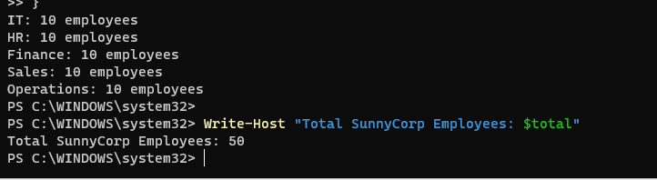
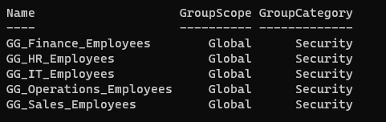

# Phase 03 — Create Employees, Departments & Company Rules

> **The simple question:** How do we give 50 employees their own accounts while keeping departmental access and computer rules consistent?

## A story anyone can follow

Picture a new company hiring 50 people. IT needs to know **who works where**, which resources each person should access, and what security settings apply to their computers.

Rather than manage 50 different permission lists by hand, SunnyCorp uses **organizational units (OUs)**, **security groups**, **PowerShell automation**, and **Group Policy**.

## The fictional organization

| Department | Original staff | Access group |
|---|---:|---|
| IT | 10 | `GG_IT_Employees` |
| HR | 10 | `GG_HR_Employees` |
| Finance | 10 | `GG_Finance_Employees` |
| Sales | 10 | `GG_Sales_Employees` |
| Operations | 10 | `GG_Operations_Employees` |
| **Total** | **50** | **5 department groups** |

Later, in Phase 5, we created a **51st temporary test employee** in a separate `Lifecycle-Testing` OU to demonstrate onboarding/offboarding. That account was subsequently disabled.

## What we did

### 1. Organize Active Directory

Created OUs for `IT`, `HR`, `Finance`, `Sales`, `Operations`, `Security Groups`, and `Workstations`.

**OU vs group:** An OU is an organizational container; a security group provides permission membership. They solve different problems.

### 2. Build 50 fictional employee accounts

- Created initial test users: James Wilson (`james.wilson`) in IT and Sarah Mitchell (`sarah.mitchell`) in HR.
- Created the remaining 48 employees through a PowerShell + CSV workflow.
- Used a script stored in the lab at `C:\SunnyCorp\Automation\Create-SunnyCorpUsers.ps1`.
- Temporary credentials were protected locally using Windows DPAPI rather than included in repository files.

**Security note:** The original credential files must **never** be committed to GitHub, even while the repository is private.

### 3. Assign department security groups

Placed each employee in the corresponding department group. Later phases use these same groups for file permissions and mapped network drives.

**Why groups?** When HR hires somebody, IT can add the new employee to `GG_HR_Employees` instead of separately editing every HR folder permission.

### 4. Create a workstation security baseline

Created and linked `SunnyCorp - Workstation Security Baseline` to the `Workstations` OU.

The workstation was configured with a **900-second (15-minute) inactivity lock**. We verified the policy through resulting Group Policy output and the `InactivityTimeoutSecs=900` setting.

**Verification nuance:** We validated the applied setting, but did not complete a timed, unattended physical auto-lock test.

### 5. Set the domain's account password policy

Configured the **Default Domain Policy** to include:

| Control | Lab setting |
|---|---|
| Minimum password length | 14 characters |
| Password complexity | Enabled |
| Invalid attempts before lockout | 10 |
| Lockout duration | 15 minutes |
| Counter reset | 15 minutes |

We verified the effective domain account policy with `Get-ADDefaultDomainPasswordPolicy`.

### 6. Test a real employee session

Signed into `SUNNY-CL01` with James's domain account and verified his identity/group memberships using `whoami` and `whoami /groups`.

## What we tested

| Check | Observed outcome |
|---|---|
| Original 50 users created | Completed |
| Employees grouped by department | Five groups of 10 verified |
| Workstation baseline applied | Verified by `gpresult` and registry |
| Domain password and lockout policy | Verified with AD PowerShell query |
| Domain employee login | Successful |

## Useful read-only commands

```powershell
# Count employees in a department group
(Get-ADGroupMember 'GG_HR_Employees').Count

# Verify the currently effective domain password policy
Get-ADDefaultDomainPasswordPolicy

# Confirm which policies reached the workstation
gpresult /r /scope computer
```

## Plain-English glossary

- **Security group:** A collection of users who receive common permissions.
- **Group Policy (GPO):** Central rules pushed to company computers or users.
- **Password policy:** Requirements for passwords and account lockouts.
- **PowerShell:** A command-line environment used to automate Windows administration.

## Limitations and next steps

This is a demonstration with synthetic identities and a small number of workstation sign-ins, not 50 real people logging on simultaneously. Automated account-creation scripts will be reviewed and sanitized before separate publication.

With people and policies created, we were ready to build shared file storage.


## Original evidence screenshots

**Fictional employee accounts**



**Department groups**



[Browse all screenshots](../evidence/GALLERY.md)

[← Phase 02](phase-02-active-directory.md) · [Next: Phase 04 — File Server →](phase-04-file-server.md)
