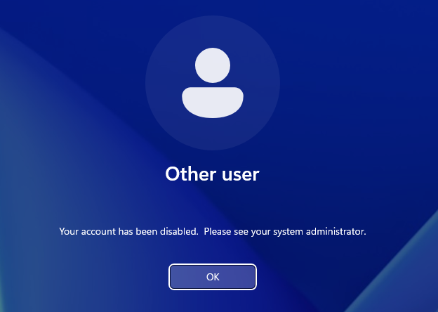
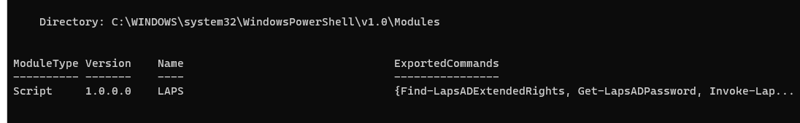
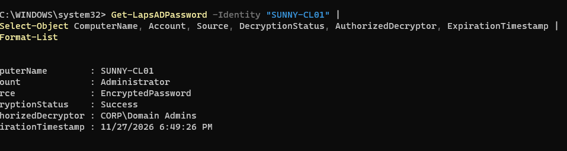
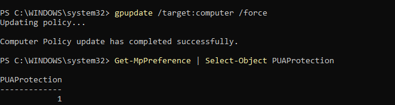
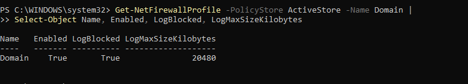
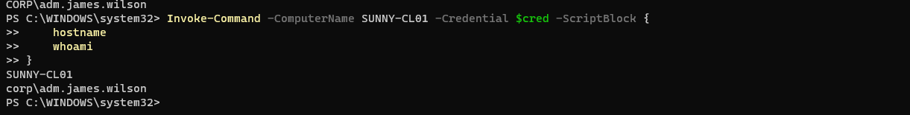

# Phase 05 — Run the IT Department & Secure the Computers

> **The simple question:** How do we manage staff changes, give IT enough authority to help people, and keep computers protected?

## The everyday explanation

Setting up a company is only the beginning. Every week somebody gets hired, leaves, needs a password reset, or needs technical help. The IT team must perform those tasks **without giving everyone unlimited power**.

Phase 5 tested the everyday operation and security of SunnyCorp's Windows environment.

## 1. Hire and offboard an employee

Created a separate **Lifecycle-Testing** organizational unit and fictional HR employee **Alex Rivera** (`alex.rivera`).

**Onboarding test:** Created account → joined `GG_HR_Employees` → logged into SUNNY-CL01 → received HR `H:` drive → Finance access denied.

**Offboarding test:** Disabled the AD account → attempted a fresh sign-in → Windows rejected it as disabled → removed HR group membership → verified `Enabled: False` using PowerShell.

**Important limitation:** Disabling an AD account prevents new domain authentication but does not automatically end every pre-existing session, VPN connection or application token. Those require a production offboarding procedure.

## 2. Separate everyday and IT administrator accounts

| Account | Purpose |
|---|---|
| `james.wilson` | Regular employee work |
| `adm.james.wilson` | IT workstation administration |

Created the security group `GG_Workstation_Admins` and a GPO linked specifically to the **Workstations OU**. The GPO **added** the group to the workstation's local Administrators group without removing existing members.

We tested that James's dedicated admin account could open an elevated PowerShell session on SUNNY-CL01, while its AD group list **did not include Domain Admins**.

**Why this matters:** If someone steals a standard account, they should not automatically receive domain administrator powers.

## 3. Manage local Administrator passwords with Windows LAPS

**LAPS** generates and rotates local administrator passwords and stores them in Active Directory with controlled access.

Work performed:

1. Verified the Windows LAPS PowerShell module.
2. Extended AD schema with `Update-LapsADSchema`.
3. Granted workstation computer self-permission on `OU=Workstations`.
4. Created **SunnyCorp - Windows LAPS** GPO: AD backup; password encryption; **20-character** complex passwords; **30-day** age policy.
5. Applied the policy and ran `Invoke-LapsPolicyProcessing`.
6. Verified workstation LAPS events **10020** (local password changed) and **10018** (AD backup successful).
7. Verified the stored record was **EncryptedPassword**, with `CORP\Domain Admins` as authorized decryptor.
8. Tested the workstation admin account: it received no password record from the unprivileged query.

**Safety:** The built-in local Administrator account was confirmed disabled and left disabled. No LAPS plaintext passwords belong in the repo.

## 4. Strengthen Microsoft Defender

Inspected antivirus service, real-time protection and threat-definition age on SUNNY-CL01.

Found that **PUA protection** was in **Audit mode (2)**; created a workstation policy for **Block mode (1)**. After `gpupdate`, `Get-MpPreference` returned **PUAProtection = 1**.

**PUA** means *potentially unwanted application* — software that may be annoying or unsafe even when not formally classified as malware.

## 5. Check the Windows Firewall

Verified the active Domain firewall was ON, with **BlockInbound,AllowOutbound** defaults.

Configured **dropped-packet logging** through the workstation security baseline, with a **20 MB** log size limit. Despite a confusing `netsh` display, `Get-NetFirewallProfile -PolicyStore ActiveStore` showed `LogBlocked=True` and `LogMaxSizeKilobytes=20480`.

**Limit:** The configuration was verified, but an actual dropped-packet log entry was not conclusively demonstrated.

## 6. Troubleshoot remotely

Enabled PowerShell Remoting / WinRM on SUNNY-CL01 and scoped the active WinRM firewall rule's allowed remote source to the lab management server `10.10.10.10`.

From SUNNY-DC01, authenticated using `adm.james.wilson` and ran remote commands to retrieve the workstation's hostname, signed-in identity and last boot time.

**Lab design note:** A dedicated privileged-access workstation is preferable to using a Domain Controller as an IT management station in a production network. One rule was scoped and verified; a comprehensive check for alternate access paths was not completed.

## 7. Review updates and privileged access

- Queried installed updates via `Get-HotFix` remotely.
- Checked BITS, UsoSvc and Windows Update services.
- Examined traditional update policy keys: values not explicitly configured.
- Checked two common reboot-pending registry indicators: both false.
- Audited SUNNY-CL01's local Administrators membership.
- Verified a local setup account was intentionally retained by the lab owner.
- Verified `james.wilson`'s ordinary account belonged to `Domain Users` and `GG_IT_Employees`, not workstation admins.

**Limit:** No online missing-patch scan was completed on the isolated virtual network. Installed updates alone do not prove full patch compliance.

## Skills demonstrated

Employee lifecycle management · Active Directory administration · GPO · Least privilege · Windows LAPS · Defender · Windows Firewall · WinRM · Patch assessment · Privilege auditing

## Original evidence screenshots

**Offboarded account blocked**

**Admin account separated**

**Encrypted Windows LAPS result**

**Defender PUA blocking**

**Effective firewall logging**

**Remote administrator session**

[Browse all screenshots](../evidence/GALLERY.md)

[← Phase 04](phase-04-file-server.md) · [Next: Phase 06 →](phase-06-security-monitoring.md)
