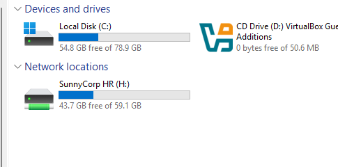
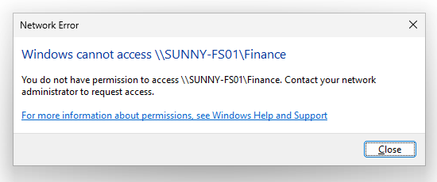
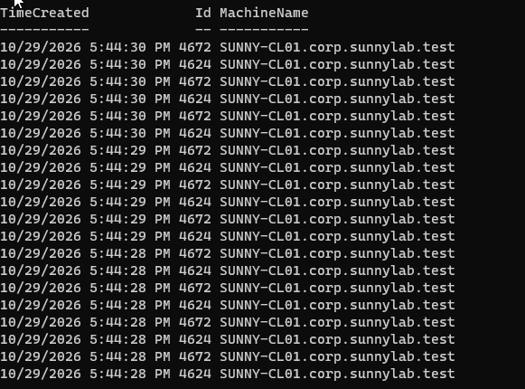
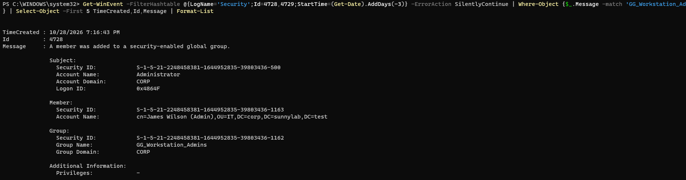

# SunnyCorp Evidence Gallery — Upload Checklist

**19 genuine screenshots from the SunnyCorp lab conversation are now in this GitHub folder.** Click the individual image links to see the actual test results.

| Phase | File to upload | What it demonstrates | Status |
|---|---|---|---|
| 1 | [View screenshot](01-network-connectivity.png) | Successful ping of the domain controller | Uploaded |
| 2 | [View screenshot](02-active-directory-promotion.png) | Domain Controller configuration completed | Uploaded |
| 2 | [View screenshot](03-domain-joined-workstation.png) | SUNNY-CL01 joined the domain | Uploaded |
| 3 | [View screenshot](04-fifty-department-employees.png) | Five departments with 10 fictional employees each | Uploaded |
| 3 | [View screenshot](05-department-security-groups.png) | Five employee security groups | Uploaded |
| 4 | [View screenshot](06-hr-network-drive.png) | HR employee mapped to H: network drive | Uploaded |
| 4 | [View screenshot](07-finance-access-denied.png) | Unauthorized Finance folder access denied | Uploaded |
| 4 | [View screenshot](08-hr-file-access-audit.png) | Event 4663 recorded an HR file access | Uploaded |
| 5 | [View screenshot](09-disabled-user-login.png) | Disabled test account blocked from signing in | Uploaded |
| 5 | [View screenshot](10-separated-admin-identity.png) | Dedicated admin account in workstation administrator group | Uploaded |
| 5 | [View screenshot](11-encrypted-laps-backup.png) | Encrypted LAPS backup with authorized decryptor | Uploaded |
| 5 | [View screenshot](12-defender-pua-blocking.png) | Microsoft Defender PUA blocking verified | Uploaded |
| 5 | [View screenshot](13-firewall-effective-logging.png) | Active firewall dropped-packet logging verified | Uploaded |
| 5 | [View screenshot](14-remote-it-administration.png) | PowerShell commands run remotely on SUNNY-CL01 | Uploaded |
| 6 | [View screenshot](15-failed-login-detection.png) | Detection script triggered on repeated failed logins | Uploaded |
| 6 | [View screenshot](16-centralized-event-forwarding.png) | Workstation security events in central collector | Uploaded |
| 6 | [View screenshot](17-forwarded-failed-logins.png) | Central collector shows two forwarded failed logins | Uploaded |
| 6 | [View screenshot](18-account-lifecycle-events.png) | AD user creation and disabling audit events | Uploaded |
| 6 | [View screenshot](19-admin-group-change-event.png) | Audited privileged-group membership change | Uploaded |

## How the screenshots were prepared

- The source files are genuine screenshots from the SunnyCorp ChatGPT lab conversation, not recreated output.
- Most remain unchanged. Two images were cropped to highlight the relevant File Explorer or access-denied dialog.
- No passwords, credential exports, or LAPS plaintext were intentionally included in the curated set.
- This is **selected evidence**, not a claim that every activity has a screenshot or that all 50 employee accounts were individually tested.

## Review before making the repository public

The images are original lab screenshots. Two were cropped to make relevant results clearer. There are no intentionally altered success values. Before publication, review each image for usernames, credential displays, system identifiers, and unrelated personal information.

## A few highlights

### HR department mapping

### Finance access denied

### Encrypted Windows LAPS backup

### Security events centralized on SUNNY-FS01

### Active Directory administrator-group change

[← Main project](../README.md)
